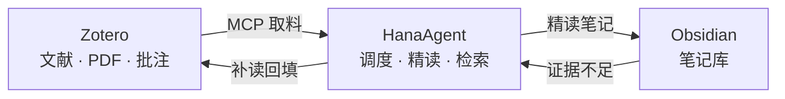

# lit-workflow

**Zotero → HanaAgent → Obsidian 论文库自动化流水线。**

把 Zotero 里的文献，经 AI 精读，沉淀为 Obsidian 中可检索、可追溯、可补读的个人论文库。



## 特性

- **批处理精读** — 按 Zotero 分类批量成文，进度日志断点续跑
- **证据优先** — 取料顺序 批注 > 全文 > PDF；结论区"发现 + 原文引用 + 页码"成对
- **只信笔记** — 检索仅基于 Vault 证据回答，依据不足时明确说明
- **补读闭环** — 证据缺口自动回 Zotero 补读，回填笔记并更新索引

## 快速开始

| 步骤 | 操作 |
| --- | --- |
| 1 · Zotero | 设置 → 高级，勾选 *Allow other applications...*；`uv tool install "zotero-mcp-server[all]"` |
| 2 · Obsidian | 安装社区插件 **Local REST API**，开启 HTTPS server，复制 API key |
| 3 · HanaAgent | 设置 → 连接器，导入 `mcp/mcpServers.example.json`（填入 API key）；启用四个 lit-* 技能 |
| 4 · 初始化 | `.\scripts\setup.ps1 -InstallMcp -VaultRoot "D:\你的Vault路径"` |

## 使用

开新会话，直接说：

| 意图 | 例句 |
| --- | --- |
| 批量精读 | 精读 Zotero 里宏基因组-软件分类的论文 |
| 单篇精读 | 精读这篇：XZRW5QNI |
| 检索问答 | Vault 里关于宿主去污染有哪些结论？ |
| 缺口补读 | 有没有论文支持 XXX 说法？ |

## 结构

```
lit-workflow/
├── skills/
│   ├── lit-collection-manager/     # 批处理调度 · 断点续跑
│   ├── lit-data-fetcher/           # 单篇取料 · 批注优先
│   ├── lit-note-writer/            # 精读成文 · 模板套用
│   └── vault-literature-retrieval/ # 检索应答 · 补读闭环
├── templates/论文精读模板.md
├── mcp/mcpServers.example.json     # 连接器配置样例
└── scripts/setup.ps1               # 安装准备脚本
```

## 常见问题

**连接器 running 但调用报错？** Zotero / Obsidian 桌面版需保持运行。

**证书问题？** HTTPS 端点用自签证书；可改用插件 HTTP 端点 `http://127.0.0.1:27123/mcp/`。

**中文关键词搜不到？** 论文标题多为英文，批处理请按分类拉取，勿依赖关键词。

## 致谢

参考 [Zotero-Analytical-Workflow-Skills](https://github.com/cheneternity/Zotero-Analytical-Workflow-Skills) 与 [Research-Vault-Literature-Retrieval](https://github.com/cheneternity/Research-Vault-Literature-Retrieval) 设计，在此基础上增加 HanaAgent MCP 连接层、检索→补读闭环与 zotero_key 追溯字段。
